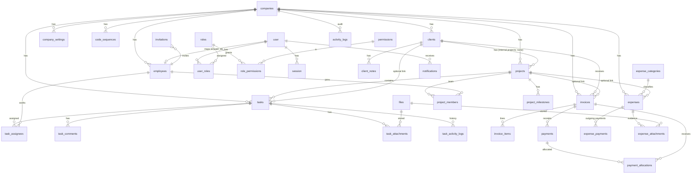

# Data Model

Logical model from blueprint §6. Column lists are the *required* fields; each owner adds technical columns (`created_at`, `updated_at`, `archived_at`, `created_by`, `updated_by`) per `02-contracts.md`. Every tenant-owned table also has `company_id` (not drawn, to keep the diagram readable). Money is `NUMERIC(14,2)`.

## Tables by owner

**Sagar** — `companies` (legal_name, display_name, email, phone, address, currency, timezone) · `company_settings` (setting_key, setting_value_json) · `code_sequences` (kind, next_value) · Better Auth `user` (email, status, last_login_at), `session`, `account`, `verification` · `invitations` (email, employee_id, role_id, token_hash, expires_at, used_at) · `roles`, `permissions`, `role_permissions`, `user_roles` · `employees` (employee_code, full_name, work_email, phone, designation, department, joining_date, profile_image_file_id, employment_status, user_id) · `clients` (client_code, name, contact_person, email, phone, address, service_type, status, notes) · `client_notes` · `projects` (project_code, name, description, type, client_id, owner_employee_id, start_date, due_date, status, budget_amount, currency) · `project_members` (membership_role) · `project_milestones` · `tasks` (task_code, project_id, client_id, title, description, priority, status, start_date, due_date, estimated_hours, actual_hours, completed_at, completed_by) · `task_assignees` · `task_comments` · `files` · `task_attachments` · `task_activity_logs` · `activity_logs`.

**Chintan** — `invoices` (invoice_number, client_id, project_id?, issue_date, due_date, status, subtotal, discount_total, tax_total, total) · `invoice_items` (description, quantity, unit_price, discount, tax_rate, line_total) · `payments` (invoice_id, amount, payment_date, method, reference, status, reversed_at, reverse_reason, idempotency_key) · `payment_allocations` · `expense_categories` · `expenses` (expense_code, category_id, payee, project_id?, expense_date, due_date, total, status) · `expense_payments` (same shape as payments) · `expense_attachments` · `idempotency_keys`.

**Shubhangi** — `notifications` (user_id, type, title, body, entity_type, entity_id, read_at) · `notification_events` (unique event_key for dedupe).

## Key constraints (from blueprint §6.4)
- Unique per company: `employee_code`, `client_code`, `project_code`, `task_code`, `invoice_number`, `expense_code`.
- Composite FK `(parent_id, company_id)` on all child tables; parents have `UNIQUE (id, company_id)`.
- `CHECK (amount > 0)`, `CHECK (quantity > 0)`; reversals are state changes plus new rows, never negative amounts.
- Client project requires `client_id`; internal project may have none (CHECK on `type`).
- `start_date <= due_date` on tasks and projects.
- Indexes: `(company_id, status)`, `(company_id, due_date)`, `project_id`, `client_id`, `task_assignees(employee_id)`, `invoices(due_date)`, `payments(invoice_id)`.
- Confirmed financial rows are never hard-deleted.

When migrations exist, regenerate this document so it matches them (blueprint handoff requirement).
